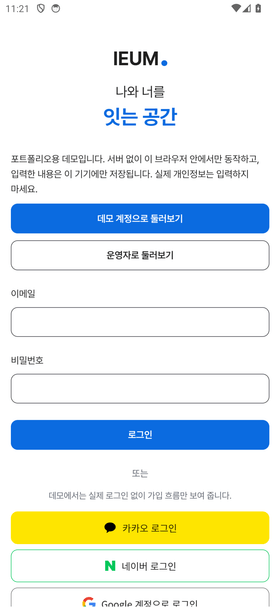
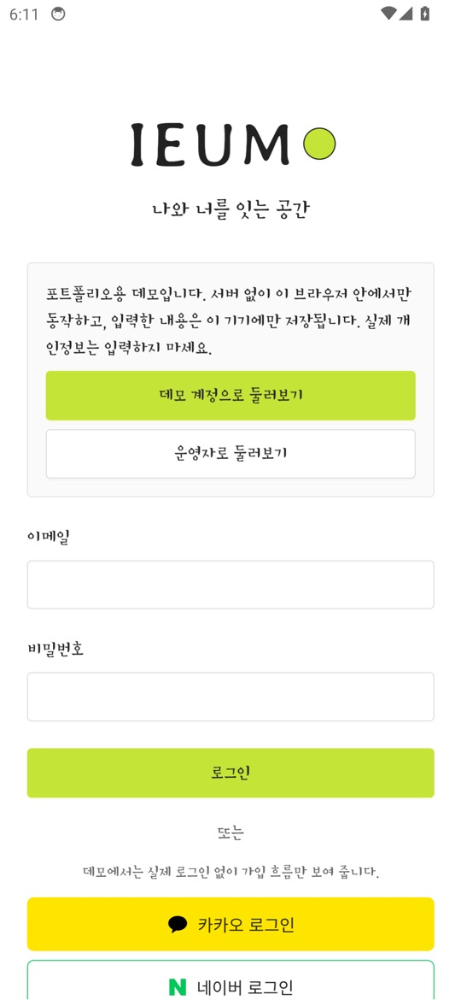
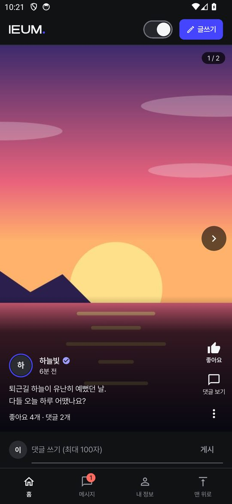
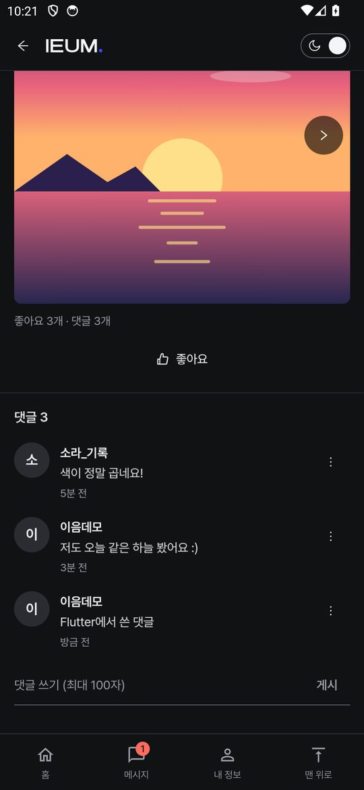
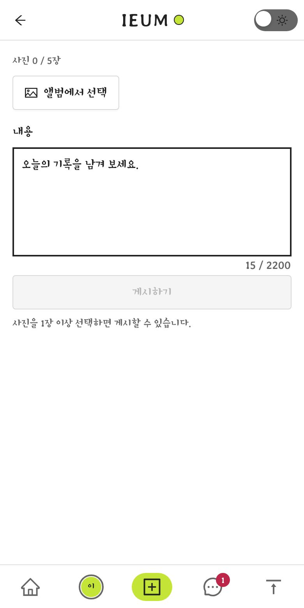
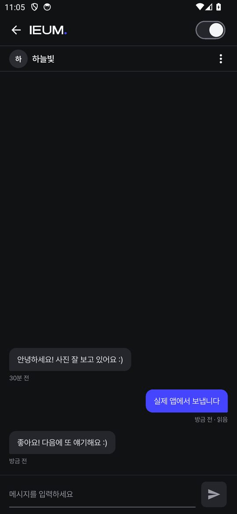
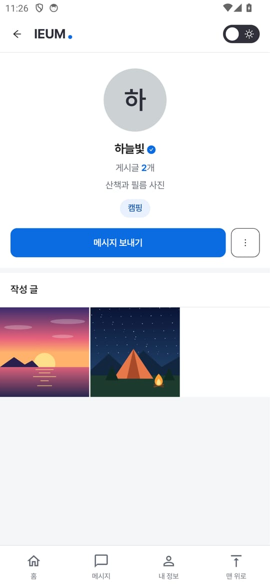
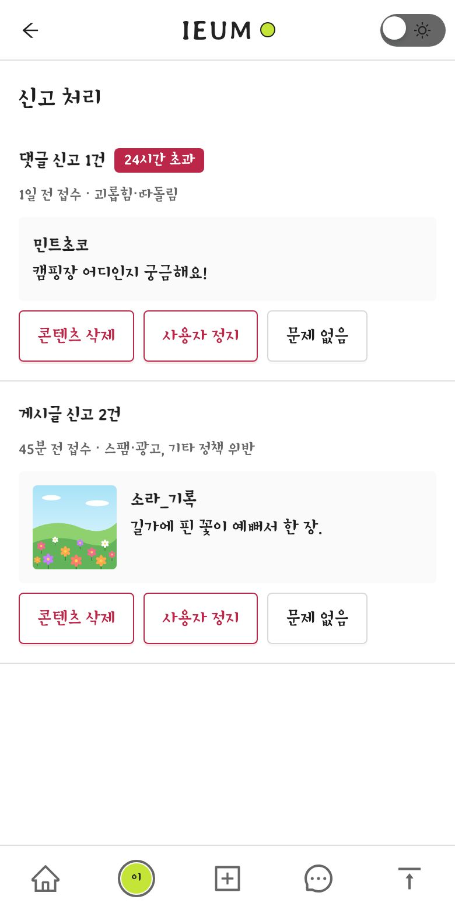
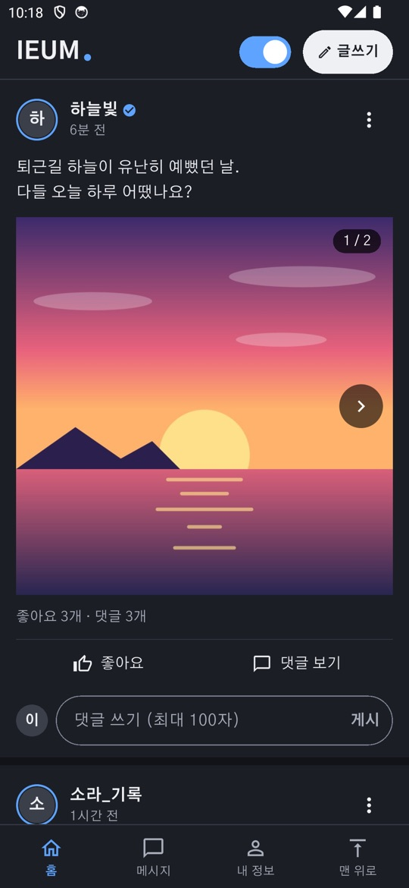

# IEUM (이음)

[](https://github.com/ryushin01/IEUM/actions/workflows/ci.yml)


**나와 너를 잇는 공간.** 사진을 공유하고 메시지를 주고받는 iOS·Android SNS 앱입니다. 피드, DM, 하단 메뉴는 Flutter 위젯으로, 나머지 화면은 웹뷰(React)로 만들고 브릿지로 연결한 하이브리드 앱입니다.

**[웹 데모 바로 보기](https://ryushin01.github.io/IEUM/)** · 가입 없이 버튼 하나로 둘러볼 수 있습니다.

> **프로젝트 상태:** 스토어에 출시하지 않는 **포트폴리오 프로젝트**입니다. 다만 출시를 전제로 심사 요건까지 설계했습니다. 웹 데모는 서버 없이 브라우저 안의 목업으로 동작합니다. 앱은 Android 에뮬레이터와 iOS 시뮬레이터에서 실행해 확인했고, 실제 기기에서는 확인하지 못했습니다. 실제 카카오·네이버·Google·Apple 로그인, 메일, S3는 가짜 서버로만 검증했고 실제 서비스와 연결하지 않았습니다.

## 화면

Android 에뮬레이터에서 실행한 앱입니다. 피드, DM, 하단 메뉴가 Flutter 위젯이고 나머지가 웹뷰입니다. 사용자와 게시글은 모두 가상 데이터이고, 사진은 직접 그린 일러스트입니다. iOS 시뮬레이터에서도 같은 흐름을 통합 테스트로 확인했습니다.



| 로그인 | 피드 |
|---|---|
|  |  |

| 게시글 상세 | 게시글 작성 |
|---|---|
|  |  |

| DM | 프로필 |
|---|---|
|  |  |

| 신고 처리 (운영자) | 다크 모드 |
|---|---|
|  |  |

## 주요 기능

| 영역 | 내용 |
|---|---|
| 계정 | 이메일 가입(닉네임 중복 확인, 관심사 최대 3개), 카카오·네이버·Google·Apple 로그인, 비밀번호 재설정, 토큰 자동 재발급, 앱 내 계정 삭제 |
| 게시글 | 작성·수정·삭제, 이미지 최대 5장, 커서 무한 스크롤, 좋아요, 댓글 100자, 공식 마크, 인기 글 표시 |
| DM | WebSocket 실시간 수신, 읽음 표시, 안 읽은 수, 재연결 후 동기화 |
| 안전 | 신고, 차단, 금칙어 필터, 약관 동의, 운영자 신고 처리(삭제, 정지), 사진 위치 정보 제거 |
| 앱 | Keychain·Keystore 토큰 저장, 네이티브 사진 선택·촬영·업로드, 오프라인 화면, 뒤로 가기, 스플래시 |

## 기술 스택


| 구분 | 사용 기술 |
|---|---|
| 앱 | Flutter(피드·DM·하단 메뉴 위젯), webview_flutter, GetX(`get`), dio, flutter_secure_storage, image_picker, url_launcher, flutter_web_auth_2 |
| 웹뷰 | React 19, Vite 8, antd 6, vanilla-extract, TanStack Query, React Router |
| API | Node.js, Fastify 5, ws, PostgreSQL(`pg`), PGlite(로컬·테스트), jose, sharp, nodemailer, S3 호환 저장소 |
| 품질 | ESLint(FSD 계층 규칙), Vitest, Storybook 10(axe), Playwright(E2E, axe), MSW(데모 API), flutter test |

## 시작하기

Node.js 24(`.node-version`), pnpm, Flutter가 필요합니다.

```bash
pnpm install
pnpm dev                   # API http://localhost:4000, 웹 http://localhost:5173

cd apps/mobile
flutter pub get
flutter run                # 개발 서버를 웹뷰로 엽니다. Android는 adb reverse 필요
```

데모 계정은 `demo@ieum.app` / `ieum-demo-1234`입니다. 운영 환경에서는 데모 데이터를 넣을 수 없습니다. 소셜 로그인 버튼은 서버에 키를 설정한 제공자만 표시합니다. ([개발 가이드](docs/development.md#소셜-로그인))

| 명령 | 설명 |
|---|---|
| `pnpm --filter @ieum/web dev:demo` | 서버 없이 데모 실행 |
| `pnpm lint` / `typecheck` | ESLint / 타입 검사 |
| `pnpm test` | API·웹 단위 테스트 |
| `pnpm --filter @ieum/web test:storybook` | 모든 스토리 렌더링과 접근성 검사 |
| `pnpm test:e2e` | 프로덕션 빌드와 실제 API의 화면 검사 |
| `pnpm --filter @ieum/web test:e2e:demo` | 데모 빌드 검사 |
| `flutter analyze` / `flutter test` | 앱 정적 분석 / 테스트 (`apps/mobile`) |
| `flutter test integration_test -d <기기> --dart-define=DEMO_MODE=true` | 시뮬레이터·기기에서 Flutter 화면, 웹뷰, 브릿지 검사 (`dev:demo` 실행 필요) |

## 프로젝트 구조

```
apps/
├─ api/      Fastify API, WebSocket, SQL 마이그레이션
├─ mobile/   Flutter 앱 (lib/feed·lib/dm 위젯, lib/data API·저장소·소켓, lib/shell 탭·웹뷰, lib/bridge 브릿지)
└─ web/      웹뷰 화면, Feature-Sliced Design (src/app·pages·widgets·features·entities·shared)
docs/        문서와 화면 이미지
```

## 문서

| 문서 | 내용 |
|---|---|
| [데모 모드](docs/demo-mode.md) | 둘러보는 방법과 실제 서비스와 다른 점 |
| [접근성 점검](docs/accessibility.md) | KWCAG 33개 항목별 결과 |
| [개발 가이드](docs/development.md) | 구조, 환경 변수, 웹뷰 빌드 도구 선택, 디자인 기준 |
| [브릿지 계약](docs/bridge.md) | 웹과 앱 사이의 메서드와 오류 코드 |
| [출시 체크리스트](docs/release.md) | 실제로 출시한다면 필요한 일 (심사 요건, 서명, 운영 배포) |
| [버전 기록](CHANGELOG.md) | 버전별 변경 내용 |

## 기여자

| 기여자 | 맡은 부분 |
|---|---|
| [ryushin01](https://github.com/ryushin01) | 프로젝트 소유자 |
| [Claude](https://claude.com/claude-code) (Anthropic) | 서버 (`apps/api`) |
