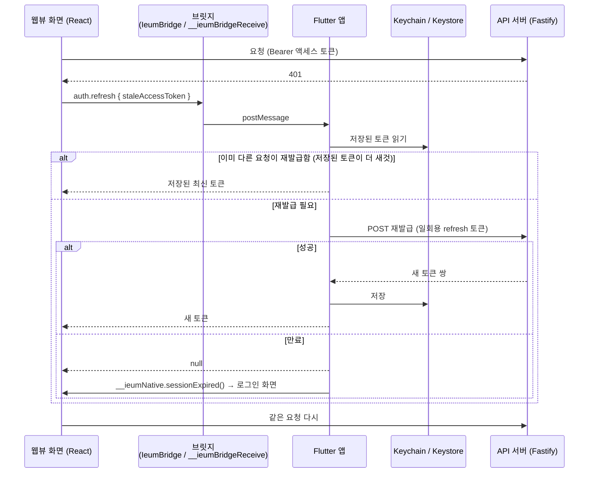
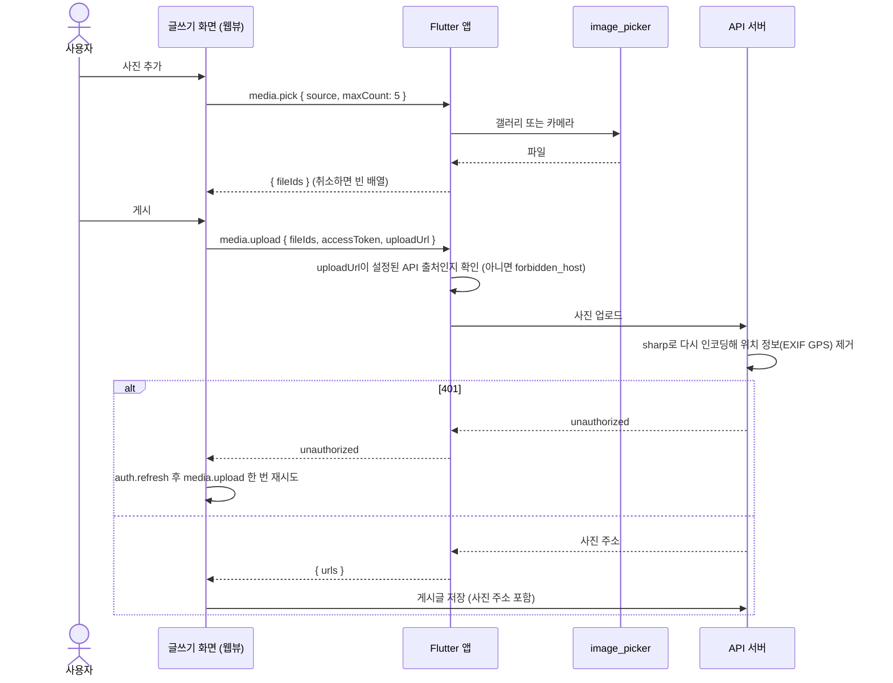
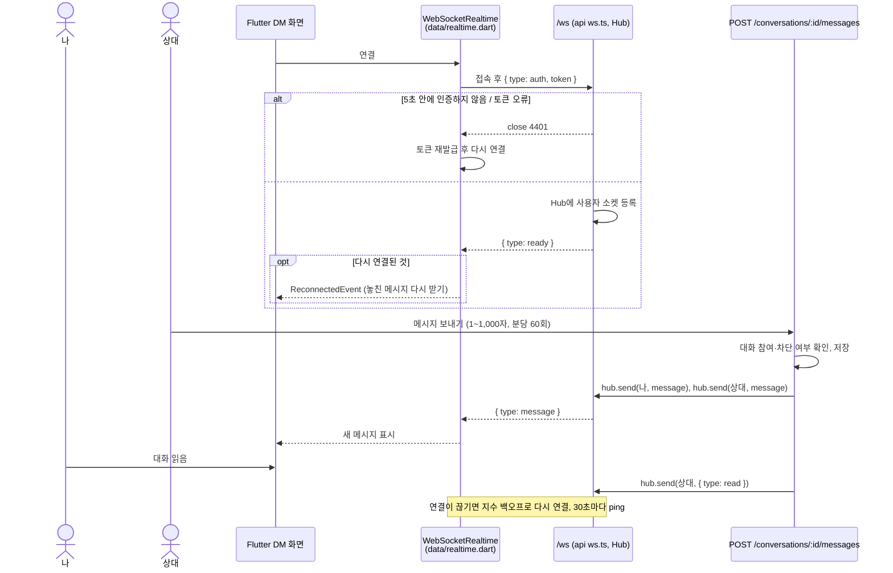

# 시퀀스 다이어그램

IEUM의 주요 흐름입니다. 피드·DM·하단 메뉴는 Flutter 위젯, 나머지 화면은 웹뷰(React)이며 둘은 [브릿지](bridge.md)로 이어집니다.

## 1. 웹뷰의 토큰 만료와 재발급

재발급 토큰은 일회용이라 재발급은 앱에서만 합니다.

## 2. 게시글 사진 고르기와 올리기

## 3. DM 실시간 수신

보내기는 REST로 하고, 웹소켓은 받기 전용입니다. 토큰이 주소에 남지 않도록 첫 메시지로 인증합니다.

